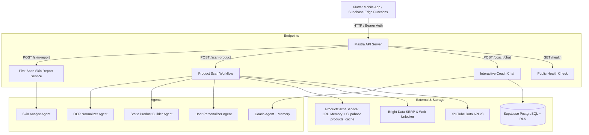

# Kora Skin Coach — AI Agent Engine

[](https://nodejs.org/)
[](https://www.typescriptlang.org/)
[](https://mastra.ai/)
[](LICENSE)

High-performance AI engine and multi-agent backend for **Kora**, a mobile skincare tracking app (built with Flutter) that proves whether a skincare routine actually works through weekly skin scans, controlled product experiments, and deterministic, medically safe AI coaching.

---

## 🔬 Core Mission & Philosophy

1. **Facts by Code, Words by LLM, Safety by Rules:**
   - Numerical scores, trend deltas, goal alignments, and routine compatibility are computed **deterministically** in pure TypeScript domain logic.
   - The LLM's role is strictly confined to empathetic, clear, non-shaming prose and personalized explanations.
2. **Zero Mathematical Hallucinations:**
   - Every number in generated reports must strictly trace back to verified user measurements.
   - The engine validates LLM outputs against raw metrics with an automatic repair loop and a 100% deterministic fallback.
3. **Cosmetic Wellness Only (Zero Medical Diagnosis):**
   - Immediate rule-based triage intercepts acute dermatological symptoms (changing moles, bleeding, pus, facial swelling, severe pain) **before** calling any model, instantly referring users to healthcare professionals.
4. **Strict Safety Gates:**
   - No prescription-only ingredients (e.g. tretinoin, hydroquinone).
   - Pregnancy & nursing safety checks enforce only `generally_ok` actives (e.g. azelaic acid, niacinamide).
   - Variations of scan scores under 3 points are strictly classified as "stable" noise.

---

## 🛠️ Architecture & System Components



### 1. Agents Roster (`src/mastra/agents/`)
- **`coachAgent`**: Conversational skincare coach backed by Mastra `Memory` (thread-scoped history + persistent `WorkingMemory` user profiles). Equipped with live Supabase tools and safe tone guardrails.
- **`skinAnalystAgent`**: Transforms normalized YouCam scan scores into a structured, inspiring "First-Scan Wow Screen" report.
- **`ocrNormalizerAgent`**: Cleans noisy ML Kit camera OCR text or raw EAN/UPC barcodes into standardized brand, product name, and search queries.
- **`staticProductBuilderAgent`**: Cosmetic formulation specialist that breaks down full INCI lists, comedogenicity/irritancy scores, fungal acne triggers, pregnancy safety, application guides, and market alternatives (including budget dupes).
- **`userPersonalizerAgent`**: Dermatological match engine that computes overall fit percentage, evaluates the 3 pillars (Skin Fit, Effectiveness, Safety), alerts on routine conflicts (e.g. Retinol + AHA/BHA), and provides personalized environmental tips.

### 2. Live Tools (`src/mastra/tools/`)
- **`concernHistoryTool`**: Queries a user's chronological score progression for a specific concern (e.g. acne, redness, wrinkles) over 2 to 26 weeks.
- **`experimentDetailsTool`**: Inspects active product experiments to determine baseline vs. follow-up efficacy verdicts.
- **`suggestActionTool`**: Generates structured in-app action buttons for the Flutter client (e.g., *"Test this serum"*, *"Take a scan"*).
- **`productAcquisitionTool`**: Coordinates parallel web data extraction across Bright Data and YouTube.

### 3. Workflows & Services (`src/mastra/workflows/` & `src/mastra/services/`)
- **`skincareScanWorkflow`**: 3-step orchestration pipeline:
  1. `normalizeInputStep`: Cleans packaging text / barcode.
  2. `resolveStaticProductStep`: Checks 60-day LRU + Supabase cache. On cache hit, avoids web scraping ($0 cost). On cache miss, scrapes and compiles static formulation data.
  3. `personalizeReportStep`: Tailors product data to user skin type, sensitivities, routine, and UV/humidity environment.

---

## 🔒 Security & Guardrails

- **Fail-Closed Authentication**: All non-health API routes require `Authorization: Bearer <MASTRA_API_SECRET>`. Unset secrets or mismatched tokens immediately reject requests.
- **Row-Level Security (RLS)**: Client requests supply the user's JWT (`x-user-jwt`). Database operations act *as the signed-in user*, guaranteeing zero cross-tenant access without exposing Supabase `service_role` keys.
- **Privacy & Image Safety**: Photos never touch the LLM (no image inputs). Only raw numeric vectors and textual metadata are processed.
- **Sensitive Data Observability**: Built-in DuckDB observability pipeline with `SensitiveDataFilter` stripping PII, emails, tokens, and authorization headers from logs and spans.

---

## 🚀 Getting Started

### Prerequisites
- Node.js >= 22.13.0
- npm >= 10.0.0
- Docker (optional, for containerized deployment)

### 1. Installation
```bash
git clone https://github.com/your-org/kora-skin-coach.git
cd kora-skin-coach
npm install
```

### 2. Environment Configuration
Copy the sample environment file and configure your API keys:
```bash
cp .env.example .env
```

| Variable | Description | Required |
| :--- | :--- | :---: |
| `MASTRA_API_SECRET` | Shared secret for internal Bearer token authorization | **Yes** |
| `GOOGLE_GENERATIVE_AI_API_KEY` | Google Gemini API Key (`gemini-2.5-flash`) | **Yes** |
| `SUPABASE_URL` | Supabase project REST URL | **Yes** |
| `SUPABASE_ANON_KEY` | Supabase public anonymous key | **Yes** |
| `SUPABASE_DB_URL` | PostgreSQL connection string (Supabase Pooler port 6543) | For Production |
| `BRIGHTDATA_API_KEY` | Bright Data API key for SERP Mega-Query & Unlocker | For Product Scans |
| `BRIGHTDATA_SERP_ZONE` | Bright Data SERP zone identifier (default: `agent_serp`) | For Product Scans |
| `BRIGHTDATA_UNLOCKER_ZONE`| Bright Data Web Unlocker zone (default: `agent_unlocker`) | For Product Scans |
| `YOUTUBE_API_KEY` | Google YouTube Data API v3 key | For Product Scans |
| `COACH_MODEL` | Primary LLM model ID (default: `google/gemini-2.5-flash`) | Optional |

### 3. Running Locally
```bash
# Run in development mode with hot reload & Mastra Studio on port 4111
npm run dev

# Run static type checking
npm run typecheck

# Run automated test suites (34 tests covering guardrails, workflows, & domain logic)
npm test

# Build production bundle (.mastra/output)
npm run build

# Start production server locally
npm run start
```

---

## 📡 API Reference

### 1. Health Check
- **`GET /health`** (Public)
  - Returns `200 OK` with `{ "status": "ok", "service": "kora-skin-coach", "timestamp": "..." }`.

### 2. First-Scan Skin Report
- **`POST /skin-report`** (Bearer Auth)
  - **Body**: `{ "scan": NormalizedScan, "profile": UserProfile }`
  - **Response**: Complete first-scan analysis report with measured scores, identified strengths, routine skeleton, and goal validation.

### 3. Product Scan & Analysis
- **`POST /scan-product`** (Bearer Auth)
  - **Body**:
    ```json
    {
      "rawInput": "3337875545778",
      "userProfile": {
        "skinType": "combination",
        "concerns": ["acne", "hydration"],
        "sensitivities": ["fragrance"],
        "isPregnantOrBreastfeeding": false,
        "isFungalAcneProne": false,
        "currentRoutineIngredients": ["Salicylic Acid 2%"],
        "environment": { "uvIndex": 6, "humidity": 50 }
      }
    }
    ```
  - **Response**: Full `SkincareReport` including match percentage, 3 pillars, INCI breakdown, routine conflict alerts, and market alternatives.

### 4. Interactive Coach Chat
- **`POST /coach/chat`** (Bearer Auth)
  - **Headers**: `x-user-jwt: <jwt>`, `x-user-id: <uuid>`
  - **Body**:
    ```json
    {
      "message": "My cheeks have been red since starting the new serum, should I stop?",
      "threadId": "thread_abc123"
    }
    ```
  - **Response**:
    ```json
    {
      "text": "...",
      "isRedFlag": false,
      "suggestedAction": {
        "type": "open_routine",
        "label": "Review Active Routine",
        "payload": {}
      }
    }
    ```

---

## 🐳 Docker & Production Deployment

The project includes an optimized multi-stage [Dockerfile](Dockerfile) and [.dockerignore](.dockerignore):

- **Base Image**: `node:22-slim`
- **Security**: Non-root execution under `USER node`
- **Bundle**: Standalone production build generated by `mastra build` into `.mastra/output`
- **Healthcheck**: Built-in container health check querying `/health` using native Node 22 fetch

### Build & Run Container
```bash
# Build the production Docker image
docker build -t kora-skin-coach .

# Run container with environment variables
docker run -d \
  --name kora-coach \
  -p 4111:4111 \
  --env-file .env \
  kora-skin-coach
```

Compatible out of the box with **Railway**, **Google Cloud Run**, **Render**, **Fly.io**, or **AWS ECS/Fargate**.

---

## 🧪 Testing & Quality Assurance

The codebase enforces strict quality controls:
- **`tests/domain-safety.test.ts`**: Verifies deterministic red flag detection and medical referral base messages.
- **`tests/enterprise-guardrails.test.ts`**: Verifies fail-closed authentication middleware and security boundaries.
- **`tests/report-validator.test.ts`**: Tests report validation, banned wording detection, and numerical consistency.
- **`tests/skincare-scan.test.ts`**: End-to-end testing of OCR normalization, cache hit/miss flows, and schema contracts.
- **`tests/supabase.test.ts` & `tests/tools.test.ts`**: Validates RLS client instantiation and tool schema constraints.

Run all tests:
```bash
npm run typecheck && npm test
```

---

## 📄 License

Apache-2.0. Built for the Kora Skincare ecosystem.
